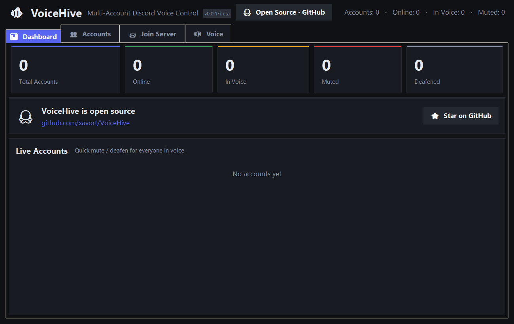
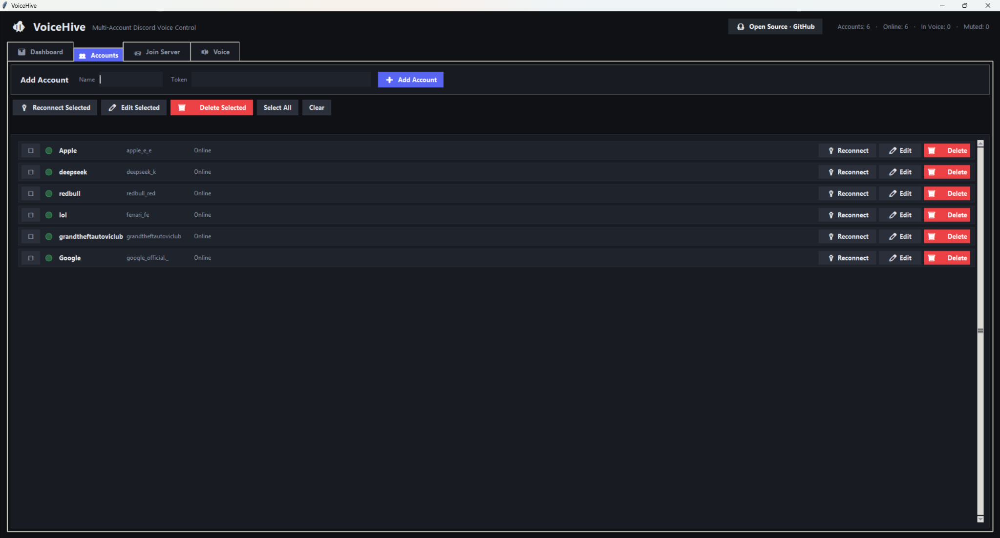
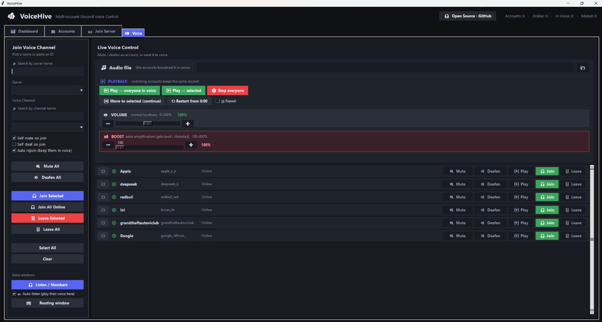

<div align="center">


# VoiceHive

**One window for a pile of Discord accounts — join channels, play audio, and actually hear the room.**


</div>

---

> ### ⚠️ Beta, and use at your own risk
>
> This is **v0.0.1-beta**. It works, but it is early and things break.
>
> Automating a **user** account breaks Discord's Terms of Service. Your account
> can get rate-limited, suspended or banned, and the ban can land by account,
> by IP/network or by device — so **other accounts on the same connection,
> including your main one, can be affected even if you never used this tool on
> them**. I have no control over that and take no responsibility for it. Don't
> run this on an account you care about.
>
> Full text: [SECURITY.md → Disclaimer and terms of use](SECURITY.md#disclaimer-and-terms-of-use).

## What is this?

VoiceHive is a Windows desktop app that keeps several Discord accounts signed in
at the same time and drives their voice connections from one screen. Send every
account to the same channel, split them across servers, mute or deafen them one
by one, play an audio file into a channel, and — the part that took me the
longest — **listen to what's actually happening in the channel** through your
own speakers.

It's a Tkinter app, so it opens instantly and there's nothing to compile. The
only runtime dependency is `discord.py-self` with the voice extra.

## Why I built it

I run a few accounts for testing voice bots, and Discord's own client is not
great at holding a session together once you're the one driving it. Joining a
voice channel kept timing out, it gave up without telling me why, and there was
no way to check whether the join had actually worked. So this started as "one
window where I can see all of them" and grew a real voice receive pipeline
along the way.

The receive side is the interesting part. discord.py-self hands you the voice
socket and the `SPEAKING` event, which is enough for both the packets and the
`ssrc → user_id` map. After that it's decrypt (DAVE/E2EE when the channel uses
it) → Opus decode → mix → play. Playback goes through `winmm` via `ctypes`, so
nothing extra gets installed.

## Screenshots

**Dashboard** — account state, quick actions, and the link back to this repo.



**Accounts** — add, edit and bulk-import your tokens.



**Join Server** — accept an invite with every selected account at once.


**Voice** — search a server or channel by name and send accounts there, play an
audio file, and open the Live Listen window.



## Features

- As many accounts as you like, each with its own state, name and avatar.
- Voice joins that don't hang: moving an account to another channel reuses the
  existing connection instead of disconnecting and reconnecting.
- When a join fails you get a reason instead of a spinner: channel full
  (`99 user limit`), missing `CONNECT` permission, locked channel, or the raw
  Discord error.
- Live listen: every speaker in the channel that account is sitting in, mixed
  into your speakers.
- Per-speaker volume sliders and a mute-for-me toggle.
- Record what you hear — the ⏺ button dumps the last 10 seconds to a WAV file.
- A speaker test tone, so you can tell "no audio" apart from "wrong output
  device".
- Play an audio file into a channel, with optional looping and its own
  volume/boost controls.
- A routing window for fanning accounts out across servers and channels.
- Auto-un-deafen: Discord doesn't send audio to a deafened member, so the app
  quietly undoes it while the listener is on.
- A stall watchdog: if packets stop arriving on a channel that's clearly alive,
  the listener gets re-attached on its own.

## Requirements

- Windows 10 or 11
- Python 3.11+ (developed on 3.13)
- `discord.py-self[voice]`
- FFmpeg, only for the "play a file" feature. It's found on `PATH`, in
  `%LOCALAPPDATA%\Microsoft\WinGet\Links\ffmpeg.exe`, or as `ffmpeg.exe` next to
  `main.py`.

## Quick start

```bat
git clone https://github.com/xavort/VoiceHive
cd VoiceHive
run.bat
```

`run.bat` checks for Python and the dependency, installs them if they're
missing, then starts the app. By hand it's:

```bat
py -3.13 -m pip install -r requirements.txt
py -3.13 main.py
```

Then go to the **Accounts** tab and add a token — name, token, done. Tokens are
written to `accounts.json` right next to `main.py`. That file is git-ignored,
and it should stay that way.

## Using it

| Tab | What it does |
| --- | --- |
| **Dashboard** | Live state for every account, plus mute / deafen / play actions. |
| **Accounts** | Add, edit, remove, or bulk-import token lines (`name:token` per line). |
| **Join Server** | Join a server from an invite for all selected accounts at once. |
| **Voice** | Pick a server and channel (searchable) and send accounts there. |

Two more windows open from the top bar:

- **🎧 Live Listen & Members** — the sidebar lists every account that's in a
  voice channel. Pick one, hit **Start listening**, and everyone in that channel
  comes out of your speakers. **Test my speakers** plays a tone, **⏺ Save 10s**
  writes a WAV.
- **🗺️ Route accounts to channels** — a grid of accounts × servers when you want
  everyone in a different place.

## How listening works

```
voice UDP socket ──► add_socket_listener
        │
        ├─ parse RTP header (plus the encrypted header extension)
        ├─ decrypt payload      ── davey (DAVE / E2EE) when the channel uses it
        ├─ Opus decode          ── discord.opus (libopus that ships with discord.py-self)
        ├─ mix into a small jitter buffer keyed on the RTP timestamp
        │                          (~4 frames, so late packets still land in order)
        └─ winmm waveOut        ── ctypes, nothing extra to install
```

A few things I ran into, in case you want to poke at it:

- The `SPEAKING` event on the voice websocket is the only source for the
  `ssrc → user_id` map, so the websocket hook has to be in place before packets
  start arriving.
- Discord's E2EE header extension sits in front of the DAVE frame, and the
  length isn't signalled directly. The code tries the plausible split points and
  keeps whichever one decrypts (a wrong guess just fails the auth tag).
- Playback is scheduled by RTP timestamp, not by arrival time. That's what keeps
  it from crackling.

`voice_listen.py` is self-contained: it takes any discord.py-self `VoiceClient`
and gives you decoded PCM. `mini_voice.py` is a small standalone client built on
top of it, which I used to test the pipeline without the UI in the way.

## When a join fails

The account row says what happened instead of spinning forever:

| What you see | Meaning |
| --- | --- |
| `channel is full` | The channel hit its user limit. |
| `no permission` | The account is missing `CONNECT` on that channel. |
| `channel is private/locked` | The channel is hidden or denied for that account. |
| `joining voice…` / `moving voice…` | Handshake in progress. The app retries with a longer window before it gives up. |
| a raw Discord error | Passed through as-is so you can search for it. |

## Troubleshooting

**I hear nothing.**
Check the account isn't deafened (the app un-deafens it while listening), check
your Windows output device, and press **Test my speakers**. Silent tone means the
problem is your output device, not Discord.

**The audio crackles.**
You're probably clipping. Pull **Listen volume** / **Boost** back towards 100% —
both sliders go higher than that on purpose and will distort.

**The first join into a server is slow.**
The voice handshake involves a UDP discovery round trip and sometimes an extra
retry. The app waits and retries instead of giving up. After the first join,
switching channels is basically instant.

**"play a file" does nothing.**
FFmpeg isn't on `PATH`. Install it (`winget install Gyan.FFmpeg`) or drop
`ffmpeg.exe` next to `main.py`.

## Project layout

```
VoiceHive/
├─ main.py                    # UI, account sessions, join/route/play logic
├─ voice_listen.py            # receive pipeline: decrypt → decode → mix → waveOut
├─ mini_voice.py              # standalone voice client used for testing
├─ run.bat                    # install-if-needed + launch
├─ screenshot.bat             # refresh the PNGs in docs/ from the running UI
├─ clean.bat                  # remove __pycache__ and leftover WAV files
├─ requirements.txt           # one line, on purpose
├─ docs/                      # logo + screenshots
└─ accounts.json              # your tokens (git-ignored, never commit this)
```

## Notes and warnings

- `accounts.json` holds **user tokens**. Treat it like a password file: keep it
  out of git, out of screenshots, out of bug reports.
- **The tokens never leave your machine.** There is no server, no account, no
  telemetry and no analytics here. The app talks to Discord and to nothing else,
  and `accounts.json` is a plain local file you can delete at any time.
- One session per token. If you're logged into the same account somewhere else,
  the older session gets dropped.
- Read the [disclaimer](SECURITY.md#disclaimer-and-terms-of-use) before you
  point this at an account you'd be sad to lose.

## Contributing

Bug reports, ideas and pull requests are all welcome — see
[CONTRIBUTING.md](CONTRIBUTING.md). If it's security-related,
[SECURITY.md](SECURITY.md) explains how to report it privately.

## License

[MIT](LICENSE).
